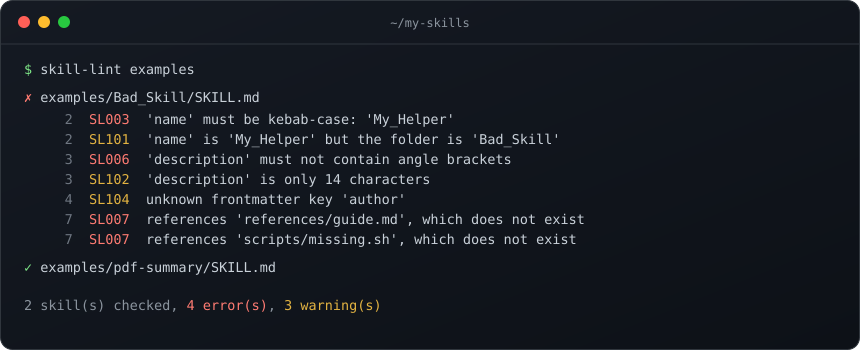

<div align="center">


# skill-lint

### Catch broken Agent Skills before your agent does.

A fast, offline linter for `SKILL.md` files: frontmatter, naming, descriptions and every file the skill points to.

[](https://github.com/shadow-lo/skill-lint/actions/workflows/ci.yml)


[](LICENSE)

[Quick start](#-quick-start) · [Rules](#-rules) · [GitHub Action](#-github-action) · [pre-commit](#-pre-commit) · [Contributing](#-development)

<br>



</div>

---

## 🤔 Why

An Agent Skill is a folder with a `SKILL.md` file. The agent reads the `name` and `description` to decide **whether** to load it,
then follows the body, which usually points at files in `scripts/` and `references/`.

When any of that is wrong, nothing crashes. The skill just **never triggers**, or it tells the agent to run a file that isn't there.
You find out weeks later, if ever.

`skill-lint` turns those silent failures into loud, line-numbered errors.

## ✨ Features

<table>
<tr>
<td width="50%" valign="top">

**🔍 Frontmatter checks**<br>
Valid YAML, required `name` and `description`, kebab-case names, length limits, unknown keys.

</td>
<td width="50%" valign="top">

**🔗 Reference checks**<br>
Every Markdown link, image and `scripts/…` path in the body must exist and stay inside the skill folder.

</td>
</tr>
<tr>
<td valign="top">

**🎯 Trigger hints**<br>
Warns when a description says *what* a skill does but never *when* to use it.

</td>
<td valign="top">

**🤖 CI ready**<br>
Text, JSON and GitHub annotation output, a ready-made Action, and clear exit codes.

</td>
</tr>
</table>

## 🚀 Quick start

```bash
pip install git+https://github.com/shadow-lo/skill-lint
skill-lint path/to/skills
```

That's it. No config file, no API key, no network.

## 🛠 Usage

```bash
skill-lint                          # scan the current folder for SKILL.md files
skill-lint path/to/SKILL.md         # check a single skill
skill-lint skills/ --strict         # treat warnings as errors
skill-lint --ignore SL101,SL103     # skip specific rules
skill-lint --reserved acme,internal # forbid words in skill names
skill-lint --format json            # machine-readable output
skill-lint --list-rules             # print every rule
```

| Exit code | Meaning |
|:---:|---|
| `0` | Clean, or warnings only |
| `1` | Errors found (or warnings with `--strict`) |
| `2` | Nothing to check, or a path doesn't exist |

## 📏 Rules

<details open>
<summary><b>Errors</b>: the skill is broken</summary>

| Code | Checks |
|------|--------|
| `SL001` | `SKILL.md` starts with a valid YAML frontmatter block |
| `SL002` | frontmatter has a `name` |
| `SL003` | `name` is kebab-case, at most 64 characters, and has no `--reserved` words |
| `SL004` | frontmatter has a `description` |
| `SL005` | `description` is at most 1024 characters |
| `SL006` | `description` has no angle brackets |
| `SL007` | local links, images and `scripts/` `references/` `assets/` paths exist inside the skill folder |
| `SL008` | the body is not empty |

</details>

<details open>
<summary><b>Warnings</b>: the skill works, but could work better</summary>

| Code | Checks |
|------|--------|
| `SL101` | `name` matches the folder name |
| `SL102` | `description` is at least 20 characters |
| `SL103` | `description` says *when* to use the skill ("Use when…") |
| `SL104` | no unknown frontmatter keys (custom fields belong under `metadata`) |
| `SL105` | the body is under 500 lines (move detail into referenced files) |

</details>

External URLs, `#anchors` and anything inside fenced code blocks are ignored.

## ⚙️ GitHub Action

Problems appear as inline annotations on the pull request diff.

```yaml
# .github/workflows/skills.yml
name: Lint skills
on: [pull_request]

jobs:
  skill-lint:
    runs-on: ubuntu-latest
    steps:
      - uses: actions/checkout@v5
      - uses: shadow-lo/skill-lint@main
        with:
          paths: skills
          strict: "true"
```

| Input | Default | Description |
|---|---|---|
| `paths` | `.` | Space-separated files or folders to scan |
| `strict` | `false` | Fail on warnings too |
| `ignore` | | Comma-separated rule codes to skip |

## 🪝 pre-commit

```yaml
# .pre-commit-config.yaml
repos:
  - repo: local
    hooks:
      - id: skill-lint
        name: skill-lint
        entry: skill-lint
        language: system
        files: SKILL\.md$
```

## 📂 Example

A skill that passes every rule:

```
pdf-summary/
├── SKILL.md
└── scripts/
    └── extract.py
```

```markdown
---
name: pdf-summary
description: Summarize a PDF into a one-page brief with key points and open questions. Use when the user shares a PDF and asks what it says.
license: MIT
---

# PDF summary

1. Extract the text with `scripts/extract.py`.
2. Write a brief: a three-sentence summary, five key points, and open questions.
```

See [`examples/`](examples) for a passing skill and a deliberately broken one.

## 🧑‍💻 Development

```bash
git clone https://github.com/shadow-lo/skill-lint
cd skill-lint
pip install -e ".[dev]"
pytest
```

Adding a rule is one function and one line in `RULES` in [`src/skill_lint/rules.py`](src/skill_lint/rules.py).

## 📄 License

[MIT](LICENSE) © shadow-lo
